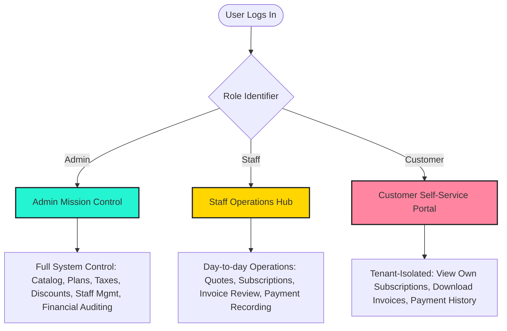

# 🌟 BRIGHTLOOP – SUBSCRIPTION MANAGEMENT SYSTEM
### *Next-Generation Recurring Revenue & Subscription Operating System*
#### Hackathon Master Edition | Complete Architecture & Implementation Blueprint

---


[](#)
[](#)
[](#)
[](#)
[](#)

---

## 📌 Executive Summary

**Brightloop** is a high-throughput, unified subscription and recurring billing SaaS engine engineered for modern enterprises that sell recurring software, modular add-ons, and multi-tier products. 

Traditional subscription workflows rely on scattered spreadsheets, manual invoice drafting, fragile memory-based renewals, and painful bank reconciliation. Brightloop replaces this operational chaos with a cohesive, automated operating system that manages the entire customer lifecycle:

$$\text{Product Catalog} \longrightarrow \text{Plan Engine} \longrightarrow \text{Quotation Template} \longrightarrow \text{Subscription Lifecycle} \longrightarrow \text{Automated Billing} \longrightarrow \text{Payment Reconciliation} \longrightarrow \text{MRR Analytics}$$

Developed specifically for the official Hackathon challenge, Brightloop merges **unforgiving financial precision** (ACID compliance, zero-double-billing idempotency, dynamic variant calculations) with a **vibrant 1990s retro-modern SaaS aesthetic** and **Penny the Coin**, an original contextual financial assistant.

---

## 🚀 Key Hackathon Differentiators

Unlike standard CRUD templates, Brightloop introduces four integrated innovations designed to captivate hackathon judges:

1. **⚡ Brightloop Financial Intelligence Center**: A proactive mission-control cockpit highlighting subscriptions nearing expiry, uncollected cash, churn risks, and expiring discount rules with 1-click mitigation actions.
2. **📈 Smart Recurring Revenue & Churn Forecaster**: Algorithmic separation of audited cash collections versus forward-looking Monthly Recurring Revenue (MRR), Annual Run Rate (ARR), and Net Dollar Retention (NDR).
3. **🔄 Automated Visual Billing Pipeline**: A kanban-style conveyor belt managing the billing lifecycle (`Due for Invoicing` $\to$ `Generated` $\to$ `Confirmed` $\to$ `Collected`) with cryptographic idempotency keys preventing duplicate invoices.
4. **🪙 Penny The Coin Mascot & Dispatch Desk**: An animated, rule-based retro financial assistant providing context-aware telemetry, renewal alerts, and billing walkthroughs based on live database queries.

---

## 🎨 Visual Identity & UI/UX Language

Brightloop is styled with a bespoke **Vibrant 90s Retro Modern Neo-Brutalist** design system adapted directly from Google Stitch UI/UX specifications:
- **Neo-Brutalism Relief**: Heavy $2.5\text{px} - 3\text{px}$ solid `#1D1E24` ink borders, crisp $3\text{px} - 4\text{px}$ hard offset shadows (zero blurry drop-shadows), and physical tactile button press states (`translate(2px, 2px)`).
- **Chromatic Palette**:
  - **Electric Mint Turquoise (`#00BFA0` / `#25F4D2`)**: Primary action buttons, active status pills, and system telemetry.
  - **Sunny Chrome Yellow (`#FFD600` / `#FFE170`)**: High-visibility callouts, warnings, promotional tags, and metric headers.
  - **Hot Watermelon Pink (`#FF4D6D` / `#FFCCD5`)**: Churn alerts, overdue warnings, and destructive actions.
  - **Electric Orange (`#FF6B00`)**: Penny mascot highlights and trial progression counters.
  - **Deep Ink Charcoal (`#1D1E24`)**: High-contrast typography and architectural structural outlines.
  - **Tactile Cream Canvases (`#FFF8EE` / `#FFF2DF`)**: Nostalgic paper-textured desktop viewports with subtle $24\text{px}$ gridlines.
- **Typographic Pairings**:
  - Headings & KPI Tickers: **Space Grotesk** (Geometric, punchy, retro-futuristic).
  - Body & Tabular Data: **Plus Jakarta Sans** (Ultra-clean, high-density legibility).

---

## 🏗️ Technology Stack Recommendation

| Layer | Recommended Technology | Justification & Hackathon Fit |
| :--- | :--- | :--- |
| **Frontend Framework** | **Next.js 15 (App Router, React 19)** | Lightning-fast Server-Side Rendering (SSR) for instant page loads, Server Actions for backend calls without API boilerplate, and dynamic streaming. |
| **Language** | **TypeScript (Strict Mode)** | End-to-end type safety across database schemas, billing math, and frontend components, eliminating runtime bugs. |
| **Styling** | **Tailwind CSS + Custom Neo-Brutalist Theme** | Complete alignment with Google Stitch design tokens; rapid assembly of retro window frames, hard shadows, and bento grids. |
| **Database & ORM** | **PostgreSQL (or SQLite for local dev) + Prisma / Drizzle ORM** | ACID transactions for financial ledger integrity, strict foreign key constraints, composite unique indexes to prevent double billing. |
| **Authentication & RBAC** | **NextAuth.js / Jose JWT + Bcrypt** | Server-side role enforcement (`Admin`, `Staff`, `Customer`), secure session management, and password complexity regex. |
| **Data Visualization** | **Custom Neo-Brutalist SVG + Lucide Icons + Material Symbols** | Pixel-perfect reproduction of Stitch dashboard charts, sparklines, donut gauges, and segmented metric meters. |
| **Recurring Billing Engine** | **Node-Cron / Serverless CRON Task Runner** | Automated periodic invoice generation running every 24 hours, evaluating active subscriptions due for billing. |
| **Mascot Engine** | **Penny SVG Component & Telemetry Hook** | Lightweight vector mascot with CSS keyframe physics reacting dynamically to live financial anomalies. |

---

## 👥 Three-Tier Role-Based Access Control (RBAC)



---

## 📁 Repository Structure & Documentation Sitemap

This repository follows a strict documentation-first engineering standard. Detailed technical specifications are located in the [`docs/`](./docs) folder:

```
Subscription-Managment/
├── README.md                              # Master overview and hackathon brief
├── CHANGELOG.md                           # Version history and milestone tracking
├── docs/
│   ├── PROJECT_OVERVIEW.md                # Problem analysis, business model & objectives
│   ├── REQUIREMENTS.md                    # Exhaustive Functional & Non-Functional breakdown
│   ├── REQUIREMENTS_TRACEABILITY.md       # Traceability matrix connecting specs to test cases
│   ├── SYSTEM_ARCHITECTURE.md             # Full layered architecture and component design
│   ├── DATABASE_DESIGN.md                 # 15 relational tables, schemas, indexes & triggers
│   ├── ER_DIAGRAM.md                      # Comprehensive Mermaid Entity-Relationship Diagram
│   ├── API_AND_BACKEND_DESIGN.md          # REST / Server Action endpoints, payloads & idempotency
│   ├── UI_UX_IMPLEMENTATION.md            # Stitch UI design system tokens, components & layout
│   ├── USER_ROLES_AND_PERMISSIONS.md      # Strict server-side RBAC and authorization matrices
│   ├── UNIQUE_SOLUTION.md                 # 4 Hackathon differentiators & judge demo pitch
│   ├── PENNY_MASCOT.md                    # Character design, SVGs, animation & dispatch engine
│   ├── DEVELOPMENT_ROADMAP.md             # 18 controlled development phases & checkpoints
│   ├── TESTING_STRATEGY.md                # Unit, integration, ACID idempotency & load testing
│   ├── SETUP_AND_INSTALLATION.md          # Developer quickstart, env vars & seed scripts
│   └── HACKATHON_DEMO_PLAN.md             # 5-minute judge walkthrough & talking points
```

---

## ⚡ Performance Guarantee: Sub-2-Second Response

To satisfy the hackathon's strict benchmark of **sub-2-second response times across thousands of subscriptions**:
1. **Aggregated Summary Views**: High-level KPI cards (MRR, Total Revenue, Overdue Counts) use materializable database aggregations rather than processing raw row arrays.
2. **Compound Indexing**: Critical query paths like `(customer_id, status)` and `(subscription_id, next_billing_date)` are indexed.
3. **Server-Side Cursor Pagination**: Data grids implement standard 25-row pagination with instant cursor lookups.
4. **Optimistic UI Updates**: Status changes (e.g., Quotation $\to$ Confirmed) trigger immediate visual updates while persisting asynchronously.

---

## 🚦 Documentation Approval & Next Steps

This repository is currently in **STAGE 2 (Technical Documentation)**. In accordance with the project brief:
- **No application code has been written.**
- **All architectural documents are published and verified on GitHub.**
- **Implementation will strictly commence once the user reviews the documentation and approves the build.**

*Designed and engineered with pride for the Brightloop Hackathon Challenge.*
