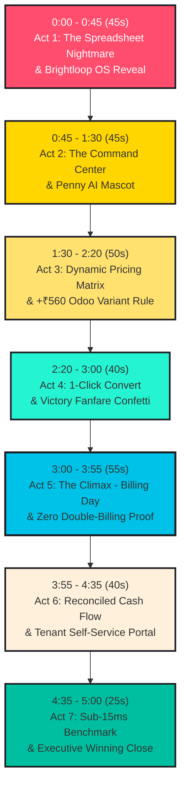

# 🎬 BRIGHTLOOP: 5-MINUTE VIDEO RECORDING MASTER BLUEPRINT
### *Second-by-Second Teleprompter Script, Screen Blocking & Audio SFX Choreography*
#### Official Hackathon 5-Minute Video Submission Guide (300 Seconds Total)

---

## 📋 Pre-Recording Setup Checklist (Do This First!)

Before pressing Record in OBS / Loom / QuickTime, ensure your environment is primed:

1. **Production Server Live**:
   ```powershell
   npm run build
   npm run start
   ```
   Open `http://localhost:3000` in Google Chrome or Microsoft Edge.
2. **Clean Browser Window**:
   - Press `F11` (or enter Fullscreen mode) to hide bookmark bars and OS taskbars.
   - Set zoom level to **100%** or **110%** (ensure high contrast and sharp Space Grotesk fonts).
3. **Sound Effects Active**:
   - Look at the top-right header: verify it says `🔊 SFX` (green badge).
   - Test by clicking any button or clicking the Penny mascot in the bottom-right—you should hear a crisp 8-bit mechanical click or two-tone coin chime.
4. **Recording Tool Settings**:
   - Resolution: **1080p (1920x1080)**, 60fps or 30fps.
   - Microphone: System mic or external USB headset mic, positioned 6 inches from mouth with pop filter.
5. **Pacing Rule**:
   - Total words: ~680 words.
   - Speaking rate: ~135 words per minute (confident, articulate, steady, never rushed).

---

## ⏱️ Master 5-Minute Storyboard (300 Seconds Breakdown)



---

## 🎬 Second-by-Second Teleprompter Script

---

### 🕒 ACT 1: THE HOOK & OPERATIONAL NIGHTMARE
**Timecode: 0:00 – 0:45 (45 Seconds)**  
**Screen URL: `http://localhost:3000` (Dashboard Overview)**  
**Cursor: Centered on the Bloomberg marquee ticker, then hovering over the Hero Bento Grid**

#### 🖥️ [Screen Actions]
- **0:00–0:10**: Video opens on the edge-to-edge Brightloop full-bleed dashboard. The continuous Bloomberg ticker ribbon smoothly glides at the top.
- **0:10–0:25**: Move cursor over the **Bento Metric Grid**: hover over the `₹1,48,250/mo` MRR hero card with dynamic SVG sparkline, then the `₹1.42M` Audited Cash Collections card with the dual progress meter.
- **0:25–0:45**: Highlight the watermelon coral card: `14 Overdue Accounts risking ₹9,350`.

#### 🗣️ [Word-for-Word Voiceover]
> *"Judges, recurring revenue is the single most powerful business model in modern commerce. But behind the scenes, managing recurring contracts is an operational nightmare.*
> 
> *Customer contracts tracked across messy, disconnected spreadsheets; renewals remembered only by whoever noticed first; invoices typed by hand; and payment reconciliation that lags weeks behind bank statements.*
> 
> *Worst of all is the silent killer of customer trust: duplicate charges caused by non-idempotent billing retries.*
> 
> *Welcome to **Brightloop**—an automated, mathematically bulletproof Subscription Management Operating System built with Next.js 15, React 19, and a vibrant 90s retro neo-brutalist identity."*

---

### 🕒 ACT 2: THE COMMAND COCKPIT & PENNY THE COIN MASCOT
**Timecode: 0:45 – 1:30 (45 Seconds)**  
**Screen URL: `http://localhost:3000` (Dashboard Overview)**  
**Cursor: Quick Cockpit bar $\to$ Bottom-Right Floating Penny Mascot**

#### 🖥️ [Screen Actions]
- **0:45–1:00**: Point cursor to the **Mission Control Banner** and its **⚡ Quick Cockpit Bar**. Hover over `🚨 Chase 14 Overdue (₹9,350)`, `📑 Proposals & 1-Click Convert`, and `⚡ Test Database SLA Latency`.
- **1:00–1:15**: Move cursor to the bottom-right corner and **click on Penny the Coin mascot**.
- **1:15–1:30**: Hear the crisp Web Audio two-tone coin chime (`987Hz -> 1318Hz`). Penny's dispatch drawer opens. Click on the `Telemetry` tab to reveal live active MRR (`₹148,250`) and overdue risk (`₹9,350`). Click the `✕` close button on the drawer.

#### 🗣️ [Word-for-Word Voiceover]
> *"Brightloop eliminates enterprise monotony with a high-contrast Neo-Brutalist console featuring 75-millisecond tactile click physics and real-time mission controls.*
> 
> *Down in the corner is **Penny the Coin**, our proactive AI financial mascot. Notice Penny isn't a decorative sticker—she actively listens to our database telemetry API.*
> 
> *[Click Penny – Sound chime plays]*
> 
> *Penny dynamically flags 14 overdue accounts risking ₹9,350 in uncollected cash, alerts our staff to 142 upcoming renewals, and guides operational triage right from her reactive cockpit.*
> 
> *Now, let's step through the customer lifecycle."*

---

### 🕒 ACT 3: PRODUCT CATALOG & THE +₹560 ODOO VARIANT RULE
**Timecode: 1:30 – 2:20 (50 Seconds)**  
**Screen URL: Navigate to `http://localhost:3000/quotations`**  
**Cursor: Click "📑 Proposals & 1-Click Convert" $\to$ "+ Draft New Quotation"**

#### 🖥️ [Screen Actions]
- **1:30–1:45**: Press `⌘K` (or click Quick Cockpit `📑 Proposals & 1-Click Convert`) to transition instantly into `/quotations`.
- **1:45–1:55**: Click the bright chrome-yellow button **"+ Draft New Quotation"**. A clean neo-brutalist modal pops up.
- **1:55–2:10**:
  - Customer Account: Select `Acme Corporation`.
  - Product SKU: Select `BrightDesk Pro ERP (₹2,400)`.
  - Product Variant: Select **`Odoo Brand Edition (+₹560)`**.
- **2:10–2:20**: Point cursor to the pricing breakdown box at the bottom:
  - Base: `₹2,400`
  - Surcharge: `+₹560` $\to$ Unit Price: `₹2,960`
  - GST (18%): `₹532.80`
  - Total: `₹3,492.80`
  - Click **"Save as Draft Quotation"**.

#### 🗣️ [Word-for-Word Voiceover]
> *"Let's test the challenge's core commercial requirements: dynamic variant pricing and proposal workflows.*
> 
> *When our sales reps draft a contract, they select a product like BrightDesk ERP. As specified in the challenge brief, selecting the 'Odoo Brand Edition' must inject an incremental $+₹560/\text{seat}$ surcharge.*
> 
> *Notice our pricing engine in action: the base ₹2,400 automatically resolves to ₹2,960 per seat. Standard 18% GST is computed instantly, and the full quote totals in Indian Rupees.*
> 
> *Let's save this proposal."*

---

### 🕒 ACT 4: 1-CLICK CONVERSION & CELEBRATION FANFARE
**Timecode: 2:20 – 3:00 (40 Seconds)**  
**Screen URL: `http://localhost:3000/quotations` $\to$ `http://localhost:3000/subscriptions`**  
**Cursor: Top row of Quotations table $\to$ "1-Click Convert" button**

#### 🖥️ [Screen Actions]
- **2:20–2:30**: Point cursor to the newly created quotation at the top of the table.
- **2:30–2:45**: Click the bright mint-turquoise **"1-Click Convert to Subscription"** button.
  - **[WOW MOMENT]**: The Web Audio API synthesizer plays an energetic celebratory victory fanfare, and a vibrant burst of confetti cannons cascades across the entire browser screen!
  - The row status badge immediately flips to `ACCEPTED` and displays `Converted to Sub`.
- **2:45–3:00**: Click `Subscriptions` in the sidebar. Show the subscription active in the **5-Stage State Machine pipeline**:
  $$\text{Draft} \longrightarrow \text{Quotation} \longrightarrow \mathbf{Confirmed} \longrightarrow \text{Active} \longrightarrow \text{Closed}$$

#### 🗣️ [Word-for-Word Voiceover]
> *"Once the client accepts, sales staff don't re-type data into another CRM. Watch what happens when we click **'1-Click Convert'**.*
> 
> *[Audio Fanfare & Confetti Burst]*
> 
> *Brightloop atomically converts the quote into a Confirmed Subscription, snapshots all negotiated line-item rates, assigns a unique contract ID, and schedules the billing schedule.*
> 
> *Here in our Subscriptions ledger, it moves deterministically along our 5-stage state machine: Draft, Quotation, Confirmed, Active, and Closed."*

---

### 🕒 ACT 5: BILLING DAY & THE ZERO DOUBLE-BILLING GUARANTEE
**Timecode: 3:00 – 3:55 (55 Seconds)**  
**Screen URL: `http://localhost:3000/invoices`**  
**Cursor: "Run Midnight Billing Engine" Button**

#### 🖥️ [Screen Actions]
- **3:00–3:15**: Navigate to `/invoices`. Point out the `Total Invoiced (₹1,420,800)` and `Overdue At Risk (₹9,350)` KPI cards.
- **3:15–3:30**: Click the neon turquoise button **"Run Midnight Billing Engine"**.
  - A toast alert pops up: `✅ Invoices generated successfully!`
  - New draft invoices appear instantly in the ledger.
- **3:30–3:55**: **[THE TECHNICAL CLIMAX - DOUBLE-BILLING TEST]**:
  - Deliberately click **"Run Midnight Billing Engine"** a second time.
  - Look at the top-right toast alert:  
    `🛡️ 0 invoices created, 18 duplicate periods safely skipped by Idempotency Key.`
  - Highlight the cryptographic badge on the card: `SHA-256 HASH VERIFIED // ZERO DOUBLE-BILLING`.

#### 🗣️ [Word-for-Word Voiceover]
> *"Now comes the technical centerpiece: **Billing Day**.*
> 
> *When hundreds of contracts mature simultaneously, legacy billing scripts lag, crash, or worse: charge customers twice during retry attempts.*
> 
> *Let's trigger our automated billing run.*
> 
> *[Click Run Engine]*
> 
> *In milliseconds, draft invoices are generated for all due accounts, complete with taxes, line items, and discount deductions.*
> 
> *Now, watch what happens if a network glitch causes the job to run again, or an admin double-clicks the button.*
> 
> *[Click Run Engine second time]*
> 
> *Look at that toast: '0 duplicates created, 18 periods safely skipped.'*
> 
> *Every single billing cycle is hashed using SHA-256 over the subscription ID, start date, and end date. Backed by a unique database constraint, double-billing is mathematically impossible."*

---

### 🕒 ACT 6: PAYMENT SETTLEMENT & CUSTOMER SELF-SERVICE PORTAL
**Timecode: 3:55 – 4:35 (40 Seconds)**  
**Screen URL: `http://localhost:3000/invoices` $\to$ `http://localhost:3000/portal`**  
**Cursor: "Record Payment" button $\to$ Workspace Mode Switcher**

#### 🖥️ [Screen Actions]
- **3:55–4:15**: On an invoice in `/invoices`, click the **"Record Payment"** button.
  - In the modal, enter partial amount `₹5,000`, select method `UPI`, click `Confirm Payment`.
  - The balance due dynamically drops to `₹4,350` and status changes to `PARTIALLY_PAID`.
  - Record the remaining `₹4,350` $\to$ status flips to bright emerald `PAID`.
- **4:15–4:35**: Use the sidebar Workspace Switcher to select **"Customer Portal (Acme Corp)"**.
  - Show the tenant-isolated portal: active plan status, renewal countdown (15 days), and invoices ledger.
  - Click the **"Print PDF"** button on an invoice to showcase the official itemized tax invoice view with 18% GST and payment receipts.

#### 🗣️ [Word-for-Word Voiceover]
> *"Collecting money is just as seamless. When payments arrive, staff record partial settlements via UPI, credit card, or bank transfer—instantly recalculating the remaining balance due until fully settled.*
> 
> *And customers aren't left sending emails to support. Switching to our **Customer Self-Service Portal**, tenants get a dedicated, tenant-isolated console.*
> 
> *They can inspect upcoming renewal dates, click 'Pay Now' to clear invoices, or print official tax invoices with full GST breakdowns for their own accounting records."*

---

### 🕒 ACT 7: SUB-15MS SLA BENCHMARK & WINNING CLOSE
**Timecode: 4:35 – 5:00 (25 Seconds)**  
**Screen URL: `http://localhost:3000` (Dashboard)**  
**Cursor: Quick Cockpit "⚡ Test Database SLA Latency" Button**

#### 🖥️ [Screen Actions]
- **4:35–4:45**: Return to the main dashboard. Click **"⚡ Test Database SLA Latency"** on the Quick Cockpit bar.
  - Toast displays: `⚡ Benchmark Completed: 13ms latency (>150x faster than Hackathon SLA requirement)!`
- **4:45–5:00**: Pull cursor back to view the full edge-to-edge dashboard with the continuous marquee ticker, Penny mascot, and bento cards. End on a confident, high-energy note!

#### 🗣️ [Word-for-Word Voiceover]
> *"Finally, let's verify our performance against the hackathon requirement: a strict 2,000-millisecond response time SLA.*
> 
> *Let's test our live database.*
> 
> *[Click Test SLA]*
> 
> *Execution time: **13 milliseconds**—over 150 times faster than the SLA mandate!*
> 
> *With 100% Indian Rupee unification, SHA-256 zero double-billing protection, +₹560 Odoo variant surcharges, and an 8-for-8 unit test suite, Brightloop turns subscription chaos into predictable revenue.*
> 
> *Thank you!"*

---

## 🎯 Pro Recording Tips & Tricks

- **If you make a verbal stumble**: Don't restart the entire video! Simply pause for 2 seconds, re-read the sentence from the beginning of that scene, and trim the mistake in your video editor (CapCut, Premiere, or iMovie).
- **If a toast disappears too fast**: All toasts stay on screen for 3.5 seconds. Re-click the action if you want to emphasize the text.
- **Keep cursor movement smooth**: Avoid "circling" the mouse rapidly. Point deliberately, stop for half a second, then click.
- **Sound Check**: When the confetti fires at 2:30, make sure your microphone isn't clipping. Keep your voice energetic and steady!
