# 🗺️ SYSTEM DEVELOPMENT ROADMAP
### *18 Controlled Phases & Checkpoint Verification Gates*

---

## 1. Roadmap Architecture & Execution Philosophy

Brightloop avoids "one giant unstructured build" by organizing implementation into **18 modular, testable, and sequentially gated phases**.

Each phase adheres to the **Documentation-First** standard:
1. Review specification and test requirements.
2. Build modular service and component logic.
3. Validate against automated tests and edge cases.
4. Execute hourly Git commits with structured semantic messages.
5. Push to GitHub and verify remote build integrity.

---

## 2. The 18 Controlled Phases

```mermaid
flowchart TD
    P1[Phase 1: Environment & Tooling Setup] --> P2[Phase 2: Complete Architecture & Docs PUSH]
    P2 --> Gate{Approval Gate: 5 Questions Answered}
    Gate --> P3[Phase 3: Database Modeling & Seeds]
    P3 --> P4[Phase 4: Auth, Password Policy & RBAC]
    P4 --> P5[Phase 5: Stitch UI Shell & Components]
    P5 --> P6[Phase 6: Admin Dashboard & Bento Grid]
    P6 --> P7[Phase 7: Products & Variant Surcharges]
    P7 --> P8[Phase 8: Plans & Recurrence Engine]
    P8 --> P9[Phase 9: Customers 360 CRM]
    P9 --> P10[Phase 10: Quotations & 1-Click Convert]
    P10 --> P11[Phase 11: Subscription 5-Stage Lifecycle]
    P11 --> P12[Phase 12: Automated Billing & Idempotency]
    P12 --> P13[Phase 13: Invoicing, Printing & Taxes]
    P13 --> P14[Phase 14: Discounts & Payment Ledger]
    P14 --> P15[Phase 15: Reports, Analytics & Charts]
    P15 --> P16[Phase 16: Customer Self-Service Portal]
    P16 --> P17[Phase 17: Penny Mascot & Differentiator]
    P17 --> P18[Phase 18: Performance Benchmarks & Pitch]

    style P2 fill:#FFD600,stroke:#1D1E24,stroke-width:2px
    style Gate fill:#FF4D6D,stroke:#1D1E24,stroke-width:3px
    style P12 fill:#25F4D2,stroke:#1D1E24,stroke-width:2px
    style P17 fill:#FF6B00,stroke:#1D1E24,stroke-width:2px
```

---

### Detailed Phase Specifications

#### 🟢 Phase 1: Environment & Tooling Setup
- Configure Next.js 15, TypeScript, Tailwind CSS, Prisma ORM, and development tooling.
- Establish repository conventions, `.gitignore`, and environment configuration.

#### 🟡 Phase 2: Complete Architecture & Initial Push (CURRENT STAGE)
- Produce complete technical documentation suite (16 markdown files in `docs/`).
- Push documentation to GitHub repository (`jishnu-prasad-1/Subscription-Managment`).
- Present architecture and ask exactly five core questions. **Stop and await user approval.**

#### 🔒 APPROVAL GATE: No coding starts until explicit user authorization.

#### ⚙️ Phase 3: Database Modeling & Realistic Seed Dataset
- Implement Prisma schema with 16 normalized entities.
- Write database seed script generating realistic portfolio data:
  - 3 User accounts (Super Admin, Sales Rep Staff, Customer).
  - 8 Products with variants (e.g. Odoo Brand +₹560).
  - 4 Recurring plans (daily, weekly, monthly, yearly).
  - 1,842 Mock subscriptions to benchmark query performance under load.

#### 🔐 Phase 4: Authentication, Password Policy & Server-Side RBAC
- Implement email uniqueness check and password regex policy (`>8` chars, uppercase, lowercase, special char).
- Implement salted `bcrypt` hashing and secure HTTP-only session cookies.
- Create server-side `requireRole(['ADMIN', 'STAFF', 'CUSTOMER'])` middleware guards.

#### 🎨 Phase 5: Reusable UI Shell & Stitch 90s OS Components
- Build persistent 72-pixel sidebar with role switcher, logo, and active window styling.
- Build top header with ⌘K search bar, notifications pill, and profile dropdown.
- Assemble Neo-Brutalist component library: `WindowCard`, `NeoButton`, `CapsuleBadge`, `RetroTable`.

#### 📊 Phase 6: Admin Mission Control Dashboard
- Construct 7-metric Bento Grid (MRR, Total Rev YTD, Active Subs, Customers, SKUs, Outstanding, Overdue).
- Integrate native SVG sparklines and segmented LED progress gauges.
- Build trailing 6-month ARR velocity dual-bar chart and tier donut chart.

#### 📦 Phase 7: Product Catalog & Variant Surcharges
- Implement Product management CRUD with name, type, sales price, cost price, and notes.
- Build multi-attribute variant engine calculating real-time surcharges (e.g. Brand = Odoo Brand adds ₹560).

#### 📑 Phase 8: Plan Management Engine
- Implement recurrence scheduling (daily, weekly, monthly, yearly).
- Implement contract rules (`auto_close`, `allow_early_closure`, `allow_pause`, `allow_renewal`).

#### 👥 Phase 9: Customer 360 CRM & Historical Timeline
- Customer profiles, tax ID (GSTIN/VAT), billing addresses, and default payment terms.
- 360-degree timeline combining subscriptions, invoices, and payment receipts.

#### 📝 Phase 10: Quotation Builder & 1-Click Subscription Conversion
- Quotation templates and custom quote builder with line items and validity bounds.
- 1-Click atomic database transaction converting approved quotes into `Confirmed` Subscriptions.

#### 🔄 Phase 11: Subscription Lifecycle State Machine
- 5-stage deterministic pipeline (`Draft` $\to$ `Quotation` $\to$ `Confirmed` $\to$ `Active` $\to$ `Closed`).
- Operational actions: Pause, Resume, Renew, and Early Close with rule enforcement.

#### ⏱️ Phase 12: Automated Recurring Billing & Idempotent Invoicing
- Background billing sweep evaluating subscriptions where `next_billing_date <= today`.
- Cryptographic idempotency key: `SHA256(sub_id + period_start + period_end)` guaranteeing zero double-billing.

#### 🧾 Phase 13: Invoicing System, Printable Layout & Automated Taxes
- Invoice lifecycle (`Draft` $\to$ `Confirmed` $\to$ `Paid`).
- Automated tax rule computation (e.g., GST 18%).
- Printable browser layout and PDF download generator.

#### 🏷️ Phase 14: Dynamic Discount Engine & Payment Ledger
- Admin-managed discount rules with min spend, seat limits, and usage cap auto-retirement.
- Multi-method payment recording with partial payment math and real-time overdue invoice detection.

#### 📈 Phase 15: Financial Analytics & Accounting Exports
- Real-time MRR, ARR, Churn, and Cash vs Accrual revenue reporting.
- Date filters and CSV export utilities.

#### 👤 Phase 16: Customer Self-Service Portal
- Tenant-isolated view of active plans, renewal countdown, downloadable invoices, and payment history.

#### 🪙 Phase 17: Penny The Coin Mascot & Intelligence Center Differentiator
- Integrate Penny vector artwork, mood states, and live telemetry dispatch banners.
- Build the **Visual Billing Control Center** and **1-Click Intelligence Center**.

#### 🏁 Phase 18: Performance Benchmarking, Security Audit & Pitch Readiness
- Verify sub-2-second response times across 10,000+ database records.
- Conduct final security audit and rehearse 5-minute hackathon judge walkthrough.

---

## 3. Hourly Git Checkpoint Protocol

During the active development phase, commits are made approximately every **one hour of active coding** and at major phase completions:
- Review `git diff` for credentials or sensitive secrets.
- Verify tests pass.
- Update `CHANGELOG.md`.
- Commit with conventional semantic message (`feat:`, `fix:`, `docs:`, `perf:`).
- Push to GitHub `main` branch and verify commit SHA.
