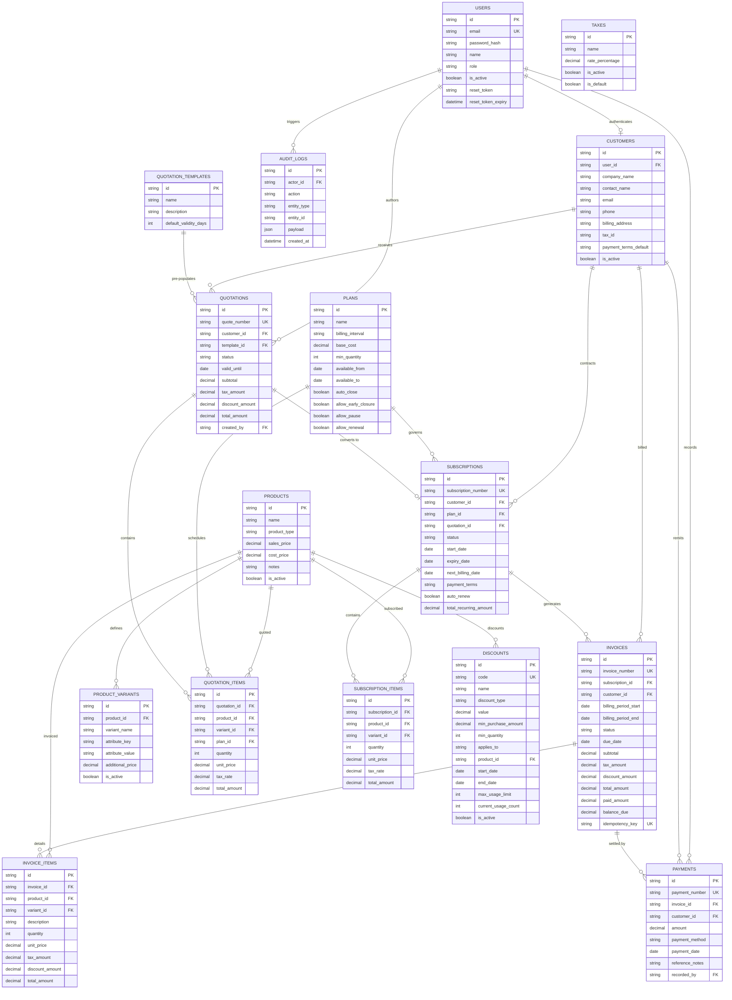

# 📊 ENTITY RELATIONSHIP (ER) DIAGRAM

---

## 1. Visual Entity Relationship Model

The following diagram illustrates the complete relational model of the Brightloop Subscription Management System, including all 16 entities, primary keys, foreign keys, and cardinalities.

---

## 2. Integrity Constraints & Cardinality Rules

1. **One-to-Many (`1:N`) between Customer and Subscriptions**: A customer may maintain multiple concurrent subscriptions across different software products and add-ons.
2. **One-to-Many (`1:N`) between Subscription and Invoices**: A single subscription generates recurring invoices over time, each distinguished by its billing period.
3. **One-to-Many (`1:N`) between Invoice and Payments**: An invoice supports multiple partial payments until `balance_due = 0.00`.
4. **Zero-or-One (`0..1:1`) between Quotation and Subscription**: An accepted quotation converts into at most one active subscription.
5. **Cascading Behavior**:
   - Deleting a draft quotation cascades and removes its quotation line items.
   - Deleting an invoice cascades and removes its invoice line items.
   - Core commercial entities (`customers`, `products`, `subscriptions`) use `ON DELETE RESTRICT` to prevent accidental deletion of historical accounting records.
