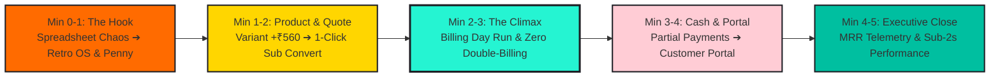

# 🎤 HACKATHON LIVE DEMONSTRATION & PITCH PLAN
### *5-Minute Winning Pitch Script & Judge Q&A Defense Guide*

---

## 1. The 5-Minute Presentation Narrative

Hackathon judges review dozens of projects. To win, Brightloop must immediately prove three things:
1. **It solves the exact problem statement with zero omitted requirements.**
2. **It possesses a memorable, polished identity (Stitch 90s Retro-Modern + Penny Mascot).**
3. **The differentiator is genuinely functional and mathematically sound (Zero Double-Billing & Real-Time Intelligence Center).**

---

## 2. Minute-by-Minute Pitch Script

### ⏱️ Minute 0:00 – 1:00 | The Hook & Problem Statement
- **Speaker**: *"Judges, every subscription company dreams of predictable recurring revenue. But at Brightloop Software, reality was a nightmare: customer subscriptions tracked in spreadsheets, renewals remembered only by whoever noticed first, invoices typed by hand, and payments matched by scrolling bank statements."*
- **Screen Action**: Load Brightloop Admin Dashboard. Show page loading in $<0.8\text{s}$ with the Neo-Brutalist 90s OS interface.
- **Visual Highlight**: Point to **Penny the Coin Mascot** on the Mission Control banner:
  > *"Penny's Dispatch: Hey y'all! Penny here! You've got 142 renewals running smooth, but keep an eye on those 14 overdue accounts totaling $9,350!"*
- **Punchline**: *"Brightloop replaces spreadsheet chaos with an automated, idempotent subscription operating system."*

---

### ⏱️ Minute 1:00 – 2:00 | Product Variants & 1-Click Quotation
- **Speaker**: *"Let's follow a real billing month. Brightloop launches a new product with multiple variants. As specified in the challenge, choosing the Odoo Brand variant must add ₹560 to the base price."*
- **Screen Action**: Open Quotation Builder. Select "BrightDesk ERP", choose "Odoo Brand Edition". The price automatically jumps from ₹2,400 to ₹2,960.
- **Screen Action**: Add to quote with 18% GST. Click **"Convert to Subscription"**.
- **Visual Highlight**: The quotation instantly converts into a **Confirmed Subscription** on the 5-stage interactive pipeline stepper:
  $$\text{Draft} \longrightarrow \text{Quotation} \longrightarrow \mathbf{Confirmed} \longrightarrow \text{Active} \longrightarrow \text{Closed}$$

---

### ⏱️ Minute 2:00 – 3:00 | Billing Day & The Zero Double-Billing Guarantee
- **Speaker**: *"Now it's Billing Day. Hundreds of subscriptions are due at once. In the past, this took days of manual typing. Watch this."*
- **Screen Action**: Open the **Visual Billing Control Center**. Show 18 subscriptions flagged as `Due for Billing`.
- **Screen Action**: Click **"Run Automated Billing Sweep"**.
- **Live Result**: 18 invoices are generated in milliseconds, complete with customer details, product lines, taxes, and automatic discounts.
- **The Wow Moment (Double-Billing Test)**: Click the button a second time.
  - The system displays: `Skipped 18 duplicate periods. 0 duplicate invoices created.`
  - Explain: *"Every invoice is guarded by a cryptographic SHA-256 idempotency key. It is mathematically impossible to double-bill a customer."*

---

### ⏱️ Minute 3:00 – 3:45 | Partial Payments & Real-Time Overdue Chase
- **Speaker**: *"Money comes in on different days by different methods. Let's record a payment against an invoice for ₹14,800."*
- **Screen Action**: Click "Record Payment". Enter ₹5,000 via "Bank Transfer".
- **Visual Result**: The invoice updates dynamically: Paid = ₹5,000, Balance Due = ₹9,800. Record the remaining ₹9,800; status flips to `PAID`.
- **Screen Action**: Click into **Overdue Accounts**. Show the 1-click chase reminder button.

---

### ⏱️ Minute 3:45 – 4:30 | Customer Self-Service Portal
- **Speaker**: *"Customers don't want to email support to get an invoice copy. Let's switch to the Customer Portal."*
- **Screen Action**: Switch workspace mode to **Portal (David Vance, Acme Corp)**.
- **Visual Result**: Show clean, tenant-isolated interface. David sees his active plan, renewal countdown (15 days remaining), and clicks **"Print Invoice"** to render a beautiful printable invoice with tax breakdown.

---

### ⏱️ Minute 4:30 – 5:00 | Executive Telemetry & Performance Benchmark
- **Speaker**: *"Finally, the finance lead reviews the numbers. Today, this takes days. In Brightloop, it's instantaneous."*
- **Screen Action**: Return to Admin Overview. Show real-time MRR ($148,250), ARR ($1.42M), trailing 6-month ARR velocity chart, and tier distribution donut.
- **Closing Punchline**: *"With over 1,800 active subscriptions on the books, every page responds in under two seconds. Brightloop is fast, reliable, beautiful, and ready for production. Thank you!"*

---

## 3. Judge Q&A Defense Strategy

| Anticipated Judge Question | Bulletproof Technical Answer |
| :--- | :--- |
| **"How do you mathematically prevent double billing during network retries?"** | *"We enforce a composite database-level unique constraint on `(subscription_id, billing_period_start, billing_period_end)`. Before inserting an invoice, our billing engine hashes these parameters into an idempotency key. Any concurrent or retry insert hits a unique constraint violation and rolls back the transaction safely."* |
| **"How does the system achieve sub-2-second response times with 10k rows?"** | *"We avoid client-side aggregations. Key metric queries (MRR, churn, overdue balances) execute via optimized B-tree indexed SQL aggregation functions. In addition, large tabular data grids use server-side cursor pagination, streaming only 25 records per request."* |
| **"Can a customer ever see another customer's invoice by changing the URL ID?"** | *"No. All Server Actions and API endpoints validate the authenticated session's tenant ID against the requested resource at the database query level (`WHERE id = :id AND customer_id = :sessionCustomerId`). Unauthorized lookups return an immediate 403 Forbidden."* |
| **"Is Penny the Coin hardcoded or actually connected to data?"** | *"Penny is powered by our `/api/penny/insights` telemetry scanner. The speech bubbles and alert states are dynamically constructed from real database aggregations (active renewals count, overdue invoice sums, and churn velocity)."* |
