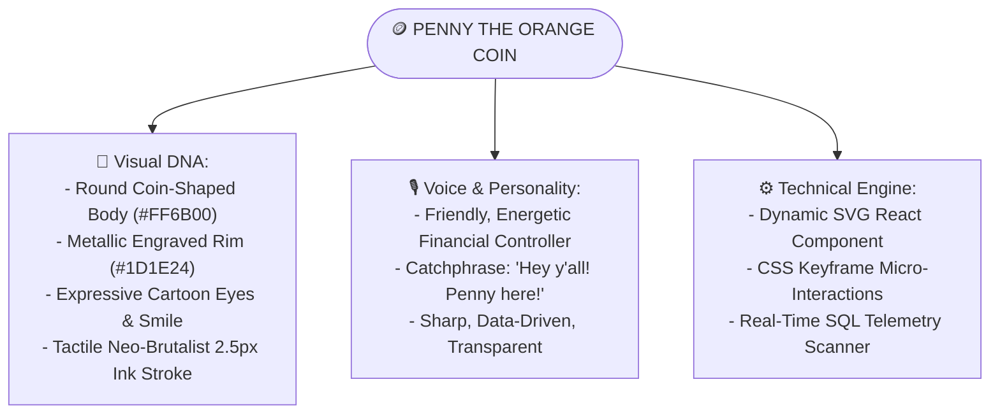

# 🪙 PENNY THE COIN MASCOT & FINANCIAL ASSISTANT

---

## 1. Character Bible & Creative Concept

**Penny** is Brightloop's original brand mascot and financial guide. Inspired by the charm, optimism, and approachable personality of classic mid-century animation, Penny transforms complex, dry subscription bookkeeping into an engaging, intuitive experience.



---

## 2. Originality & Intellectual Property Compliance

To strictly respect copyright and ensure 100% intellectual property originality:
1. **Coin, Not a Clock**: Penny is unequivocally an **antique metallic currency coin**, featuring coin ridges and an embossed center, with zero clock hands, zero numerals, and zero clock face elements.
2. **Original Facial Features**: Custom eye shapes, original mouth curvature, and distinct cartoon expressions styled specifically to harmonize with Brightloop's 90s OS interface.
3. **Original Vector Assets**: Built using proprietary inline SVGs and custom CSS animations, ensuring no copyrighted vectors, fonts, or assets are utilized.

---

## 3. Visual Specifications & Color Palette

- **Body Fill**: High-voltage Electric Orange (`#FF6B00`) with warm amber gradient shading (`#FF8533`).
- **Inner Rim & Accents**: Sunny Chrome Yellow (`#FFD600` / `#FFE170`).
- **Outlines & Features**: Heavy Deep Ink Charcoal (`#1D1E24`) in $2.5\text{px}$ vector stroke.
- **Eye Highlights**: Crisp pure white (`#FFFFFF`) with expressive pupils.
- **Mood Variations**:
  - `dispatch`: Friendly speaking expression with one hand pointing toward telemetry cards.
  - `alert`: Wide watchful eyes and raised brow, holding an exclamation pill for overdue alerts.
  - `celebrate`: Sparkly eyes, open smile, and confetti particles for zero-churn milestones or paid invoices.
  - `thinking`: Contemplative expression evaluating complex discount calculations.

---

## 4. The 10 System Touchpoints

Penny is woven thoughtfully throughout Brightloop without obstructing functional workflows:

| Touchpoint # | System Screen / Location | Penny's Role & Message Example |
| :---: | :--- | :--- |
| **1** | **Authentication: Login** | Welcoming users: *"Welcome back! Let's get your recurring revenue moving today!"* |
| **2** | **Authentication: Registration** | Contextual password coach: *"Make sure that password has 8+ characters, an uppercase letter, and a special character!"* |
| **3** | **Admin Dashboard Banner** | **Penny's Dispatch Desk**: *"Hey y'all! Penny here! You've got 142 renewals running smooth, but keep an eye on those 14 overdue accounts!"* |
| **4** | **Customer Self-Service Portal** | Friendly billing status: *"Your Enterprise plan renews on Nov 15. All your previous invoices are settled and clean!"* |
| **5** | **Floating Assistant Drawer** | A non-intrusive floating coin avatar in the bottom-right corner that expands into a quick financial summary widget. |
| **6** | **Empty States (e.g. Zero Overdue)** | Celebrating financial health: *"Yee-haw! Zero overdue invoices in the ledger. Every subscriber is paid up!"* |
| **7** | **Success Modals** | Cheerful confirmation on quote-to-subscription conversion or payment settlement. |
| **8** | **Contextual Form Tooltips** | Explaining variant pricing: *"Choosing Odoo Brand adds a ₹560 manufacturer surcharge to this base seat."* |
| **9** | **Workspace Mode Switcher** | Onboarding pill explaining the difference between Admin, Staff, and Customer viewports. |
| **10** | **Invoice Breakdown Drawer** | Demystifying line-item math: *"Here's your subtotal, minus the 15% Early Bird discount, plus 18% GST!"* |

---

## 5. Technical Implementation: Dynamic SVG & Telemetry Hook

```typescript
// components/mascot/PennyMascot.tsx
import React from 'react';

export type PennyMood = 'dispatch' | 'celebrate' | 'alert' | 'thinking';

interface PennyMascotProps {
  mood?: PennyMood;
  size?: 'sm' | 'md' | 'lg';
  className?: string;
}

export const PennyMascot: React.FC<PennyMascotProps> = ({
  mood = 'dispatch',
  size = 'md',
  className = ''
}) => {
  const sizeMap = {
    sm: 'w-12 h-12',
    md: 'w-20 h-20',
    lg: 'w-32 h-32'
  };

  return (
    <div className={`relative inline-block ${sizeMap[size]} ${className} group`}>
      <svg
        viewBox="0 0 100 100"
        className="w-full h-full drop-shadow-[2px_2px_0px_#1D1E24] transition-transform group-hover:scale-105"
      >
        {/* Outer Coin Edge & Ridges */}
        <circle cx="50" cy="50" r="46" fill="#FF8533" stroke="#1D1E24" strokeWidth="3" />
        <circle cx="50" cy="50" r="41" fill="#FF6B00" stroke="#1D1E24" strokeWidth="2" />
        
        {/* Inner Metallic Coin Ring */}
        <circle cx="50" cy="50" r="35" fill="#FFAA00" stroke="#1D1E24" strokeWidth="1.5" strokeDasharray="3 2" />
        <circle cx="50" cy="50" r="30" fill="#FF6B00" />

        {/* Eyes based on Mood */}
        {mood === 'alert' ? (
          <>
            <circle cx="40" cy="42" r="7" fill="#FFFFFF" stroke="#1D1E24" strokeWidth="2" />
            <circle cx="40" cy="42" r="3" fill="#1D1E24" />
            <circle cx="60" cy="42" r="7" fill="#FFFFFF" stroke="#1D1E24" strokeWidth="2" />
            <circle cx="60" cy="42" r="3" fill="#1D1E24" />
          </>
        ) : (
          <>
            <ellipse cx="40" cy="43" rx="5" ry="7" fill="#FFFFFF" stroke="#1D1E24" strokeWidth="2" />
            <circle cx="41" cy="43" r="2.5" fill="#1D1E24" />
            <ellipse cx="60" cy="43" rx="5" ry="7" fill="#FFFFFF" stroke="#1D1E24" strokeWidth="2" />
            <circle cx="61" cy="43" r="2.5" fill="#1D1E24" />
          </>
        )}

        {/* Retro Smile */}
        <path
          d={mood === 'celebrate' ? "M 35 55 Q 50 72 65 55 Z" : "M 36 56 Q 50 67 64 56"}
          fill={mood === 'celebrate' ? "#FFFFFF" : "none"}
          stroke="#1D1E24"
          strokeWidth="2.5"
          strokeLinecap="round"
        />

        {/* Rosy Cheeks */}
        <ellipse cx="32" cy="52" rx="4" ry="2.5" fill="#FF4D6D" opacity="0.6" />
        <ellipse cx="68" cy="52" rx="4" ry="2.5" fill="#FF4D6D" opacity="0.6" />
      </svg>
    </div>
  );
};
```

