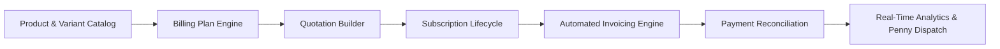

# 📄 PROJECT OVERVIEW: BRIGHTLOOP SUBSCRIPTION MANAGEMENT

---

## 1. Executive Context & Background

Brightloop Software is an innovative B2B software vendor operating in the high-growth recurring revenue ecosystem. The company markets a diverse catalog of cloud-delivered business solutions, modular functional add-ons, and multi-tier enterprise packages. 

Modern subscription businesses face complex billing and lifecycle dynamics:
- **Contractual Diversity**: Customers range from small retail establishments on flexible monthly subscriptions to multinational enterprise clients on structured multi-year contracts with customized volume commitments.
- **Product & Pricing Variations**: Products feature multiple variant dimensions (e.g., Brand editions such as the Odoo Brand integration that adds a ₹560 premium, enterprise support tiers, user seat tiers).
- **Billing Cadences**: Billing cycles vary across daily micro-charges, weekly plans, standard monthly subscriptions, and annual consolidated billing.

---

## 2. The Operational Problem: "Spreadsheet Chaos"

Before Brightloop, the company relied on disjointed, manual legacy workflows:
1. **Spreadsheet Customer Tracking**: Subscriptions were tracked in ad-hoc shared spreadsheets, causing version divergence, dropped customer records, and zero auditability.
2. **Memory-Based Renewals**: Contract expirations and renewal milestones were remembered only when someone happened to notice, leading to unintentional contract lapses and unbilled service provision.
3. **Manual Invoice Generation**: Invoices were typed by hand at the end of each billing cycle, leading to arithmetic mistakes, incorrect tax computations, missed line items, and duplicate invoices.
4. **Bank Statement Scavenging**: Payments received across bank transfers, cards, and checks were matched manually by scrolling through raw bank statements, obscuring which accounts were in arrears.
5. **Quarterly Reporting Lag**: Calculating basic financial metrics (Monthly Recurring Revenue - MRR, Annual Recurring Revenue - ARR, Churn, Outstanding Collections) required days of manual spreadsheet reconciliation.

The resulting operational liabilities:
- **Revenue Leakage**: Services provided without active invoices or following expired discounts.
- **Duplicate Billing**: Customers accidentally invoiced twice for identical billing periods.
- **Customer Frustration**: Customers forced to contact sales reps via email for basic invoice copies or subscription updates.

---

## 3. The Brightloop Solution Architecture

Brightloop replaces spreadsheet fragmentation with a **centralized, automated subscription engine**:

### Core Capabilities:
1. **Single Source of Truth**: All customers, contracts, invoices, and payments reside in an ACID-compliant relational database.
2. **Deterministic Lifecycle Progression**: Subscriptions follow a strict 5-stage state machine (`Draft` $\to$ `Quotation` $\to$ `Confirmed` $\to$ `Active` $\to$ `Closed`).
3. **Automated Idempotent Billing Engine**: Invoices are generated automatically from active subscriptions when billing is due, using unique period keys that mathematically prevent duplicate billing.
4. **Dynamic Tax & Discount Computation**: Automated rules calculate localized sales taxes and enforce discount boundaries (thresholds, date bounds, and maximum usage caps).
5. **Three Distinct User Portals**:
   - **Admin Command Deck**: Comprehensive configuration of products, plans, taxes, discounts, staff accounts, and financial health.
   - **Staff Operations Hub**: Sales reps and support staff onboard customers, issue quotations, monitor active subscriptions, and record payments.
   - **Customer Self-Service Portal**: Secure tenant-isolated area where customers review active plans, view upcoming renewal dates, download PDF invoices, and review payment history.
6. **Penny Contextual Assistant**: An original mascot and visual dispatch system that highlights actionable financial anomalies in real time.

---

## 4. Key Performance Objectives

As specified in the hackathon challenge brief:
- **Sub-2-Second Page Response Time**: Every view across the platform must load and render in under two seconds, even when managing portfolios exceeding $10,000$ active subscription records.
- **Zero Double-Billing Guarantee**: Under no circumstance should a billing job create overlapping invoices for the same subscription period.
- **Zero Plaintext Credentials**: Cryptographic hashing (bcrypt) and server-side RBAC token verification across all API routes and data mutations.
- **Responsive Retro-Modern Ergonomics**: Uncompromising adherence to the Neo-Brutalist 90s visual language across desktop, tablet, and mobile displays.
