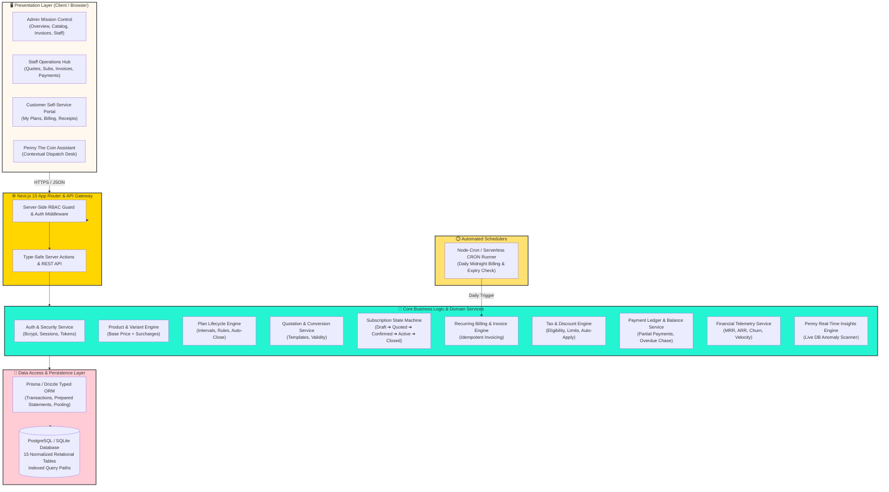
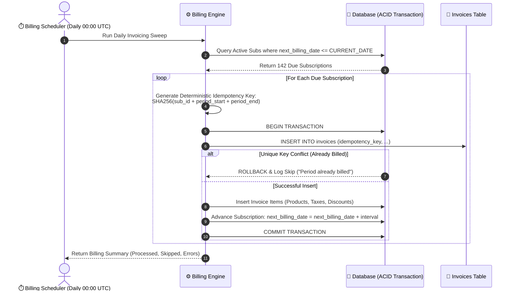

# 🏛️ SYSTEM ARCHITECTURE SPECIFICATION

---

## 1. High-Level System Architecture

Brightloop is designed as a **modern, modular, full-stack web application** adhering to clean architecture principles: separation of concerns between presentation, domain business logic, data access, and storage.



---

## 2. Technology Stack Breakdown & Rationales

### 2.1 Frontend Framework: Next.js 15 (App Router, React 19)
- **Zero API Boilerplate**: Server Actions enable direct, type-safe execution of domain logic from forms and buttons without manual `fetch()` boilerplate.
- **Instant Initial Render**: Server-Side Rendering (SSR) streams pre-rendered HTML, easily surpassing the hackathon's $<2\text{s}$ response benchmark.
- **Fine-Grained Revalidation**: Incremental Static Regeneration (ISR) and `revalidatePath` guarantee that newly generated invoices or confirmed subscriptions instantly reflect across all client tabs.

### 2.2 Styling & Design Tokens: Tailwind CSS + Neo-Brutalism Custom Presets
- Direct translation of Google Stitch design tokens:
  - Exact colors: Electric Mint (`#00BFA0`), Chrome Yellow (`#FFD600`), Hot Pink (`#FF4D6D`), Cream Canvas (`#FFF8EE`), Ink Charcoal (`#1D1E24`).
  - Tactile box-shadows: `box-shadow: 3px 3px 0px #1D1E24` and `4px 4px 0px #1D1E24`.
  - Vintage window chrome: Styled headers with `_`, `□`, `×` control pills.

### 2.3 Database & ORM: PostgreSQL / SQLite + Prisma ORM
- **ACID Transaction Guarantees**: Essential for subscription activation, invoice generation, and ledger balancing. A transaction ensures that if an invoice item fails to save, the entire invoice is rolled back.
- **Relational Integrity**: Foreign keys with `CASCADE` or `RESTRICT` prevent orphan records.
- **Portability**: Prisma provides seamless portability between local SQLite (zero-config local development during hackathon demonstrations) and production PostgreSQL (Supabase / Neon / Railway).

### 2.4 Authentication & Security: Jose JWT / NextAuth + Bcrypt
- **Bcrypt Work Factor 10**: Secure salted hashing protecting user passwords.
- **Stateless or Database Sessions**: Signed HTTP-only, SameSite cookies preventing XSS and CSRF attacks.
- **Role Verification Guard**: Every Server Action validates `session.user.role` before invoking domain operations.

---

## 3. Recurring Billing & Idempotency Architecture

One of the most critical requirements from the problem statement is:
> *"Nothing should be billed twice or skipped."*

To achieve a mathematical guarantee against duplicate invoices:



### The Idempotency Key Formula:
$$\text{Key} = \text{hash}(\text{subscription\_id} \mathbin{\Vert} \text{billing\_period\_start} \mathbin{\Vert} \text{billing\_period\_end})$$

The `invoices` table enforces a database-level `UNIQUE(idempotency_key)` constraint. Even if two concurrent background tasks or manual button clicks trigger the engine at the exact same millisecond, the database engine guarantees that only one transaction succeeds, completely eliminating duplicate billing.

---

## 4. Performance Architecture: Sub-2-Second Benchmark

To comfortably meet the performance requirement of rendering dashboards under two seconds with over $10,000$ subscription records:

1. **Pre-Aggregated Metric Queries**: Rather than running `SELECT * FROM subscriptions` and aggregating on the client, the backend executes targeted SQL aggregation functions:
   ```sql
   SELECT 
     SUM(total_recurring_amount) AS mrr,
     COUNT(*) FILTER (WHERE status = 'active') AS active_subs
   FROM subscriptions;
   ```
2. **Compound B-Tree Indexes**:
   - `idx_subs_billing`: `(status, next_billing_date)` for instant billing batch queries.
   - `idx_invoices_overdue`: `(status, due_date)` for overdue recovery alerts.
   - `idx_customer_subs`: `(customer_id, status)` for customer portal queries.
3. **Cursor-Based Pagination**: Tables stream 25 rows per page, keeping payload sizes below $50\text{KB}$.
4. **SVG Vector Visualizations**: Dashboard charts are rendered using native inline SVGs, requiring zero heavy chart libraries and eliminating browser re-paint stutter.
