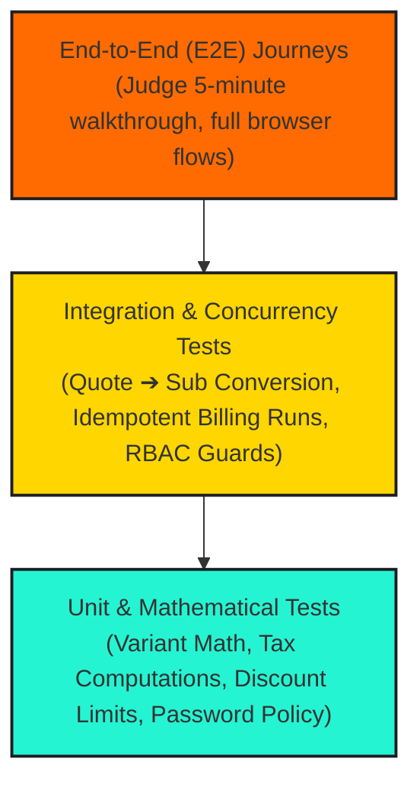

# 🧪 TESTING STRATEGY & QUALITY ASSURANCE

---

## 1. Quality Assurance Philosophy

Financial and subscription software demands **zero arithmetic tolerance** and **uncompromising state machine determinism**. 

Brightloop’s QA strategy guarantees:
1. **Mathematical Accuracy**: Calculations across unit prices, variant surcharges, tax percentages, and discount deductions must resolve to exact cents without floating-point drift.
2. **Idempotency Under Concurrency**: Billing sweeps executed simultaneously must never generate duplicate invoices.
3. **Tenant & Role Security**: Cross-tenant data leaks and privilege escalations must be impossible at the API layer.
4. **Sub-2-Second Performance**: Query latency verified under simulated enterprise volume ($10,000+$ records).

---

## 2. Testing Pyramid & Automation Framework

---

## 3. Test Cases & Verification Catalog

### 3.1 Unit Test Suite: Pricing, Taxes & Discounts

#### `TC-UNIT-01: Variant Price Addition Math`
- **Objective**: Verify variant surcharge correctly sums with base product sales price.
- **Input**: Base Product: ₹2,400.00; Variant: "Odoo Brand" (Surcharge: +₹560.00); Quantity: 5.
- **Expected Result**: Unit Price = ₹2,960.00; Line Subtotal = ₹14,800.00.

#### `TC-UNIT-02: Multi-Item Tax Rate Calculation`
- **Objective**: Verify tax rates apply accurately across taxable lines.
- **Input**: Line 1: ₹10,000 (Tax: 18% GST); Line 2: ₹5,000 (Tax: 18% GST).
- **Expected Result**: Subtotal = ₹15,000.00; Tax Amount = ₹2,700.00; Total Amount = ₹17,700.00.

#### `TC-UNIT-03: Discount Threshold & Cap Retirement`
- **Objective**: Verify discount auto-applies only when minimum spend is met and deactivates when usage cap is reached.
- **Input**: Discount rule: 10% off with min purchase ₹5,000; max usage = 2.
- **Execution**:
  - Purchase 1 (₹4,000): Ineligible; 0% discount.
  - Purchase 2 (₹6,000): Eligible; 10% applied (₹600); usage count becomes 1.
  - Purchase 3 (₹8,000): Eligible; 10% applied (₹800); usage count reaches 2 $\to$ rule marked inactive.
  - Purchase 4 (₹10,000): Ineligible (rule retired); 0% discount.

#### `TC-UNIT-04: Password Policy Regex Enforcement`
- **Objective**: Validate strict compliance with PDF page 2 password rules.
- **Test Matrix**:
  - `short1!` ($\le 8$ chars) $\to$ **FAIL**
  - `nouppercase123!` $\to$ **FAIL**
  - `NOLOWERCASE123!` $\to$ **FAIL**
  - `NoSpecialCharacter123` $\to$ **FAIL**
  - `Brightloop@2026` ($>8$, Upper, Lower, Special) $\to$ **PASS**

---

### 3.2 Integration Test Suite: Billing & Idempotency

#### `TC-INT-01: Zero Double-Billing Idempotency Guarantee`
- **Objective**: Ensure a subscription cannot be billed twice for the same billing period.
- **Procedure**:
  1. Create an active monthly subscription starting `2026-10-01` with `next_billing_date = 2026-10-01`.
  2. Execute `POST /api/billing/run-engine`.
  3. Verify Draft Invoice `INV-001` is created for period `2026-10-01` to `2026-10-31`.
  4. Immediately trigger `POST /api/billing/run-engine` a second time with identical timestamp.
  5. **Expected Result**: Database catches duplicate `idempotency_key`, logs a graceful skip, and returns 0 new invoices. No duplicate invoice is created.

#### `TC-INT-02: Partial Payment & Balance Tracking`
- **Objective**: Verify ledger balance updates accurately across staggered payments.
- **Procedure**:
  1. Generate invoice for ₹10,000.00. Initial status: `confirmed`, `paid_amount = 0`, `balance_due = 10000.00`.
  2. Record payment of ₹4,000.00 via Bank Transfer.
  3. Verify `paid_amount = 4000.00`, `balance_due = 6000.00`, status remains `confirmed`.
  4. Record second payment of ₹6,000.00 via UPI.
  5. Verify `paid_amount = 10000.00`, `balance_due = 0.00`, status automatically updates to `paid`.

#### `TC-INT-03: Cross-Tenant Data Isolation Guard`
- **Objective**: Verify customer accounts cannot read other customers' subscriptions or invoices.
- **Procedure**:
  1. Authenticate session as `customer-a` (holding `customer_id = 'cust-1'`).
  2. Send `GET /api/invoices/inv-cust-2` (belonging to `cust-2`).
  3. **Expected Result**: Server Action throws `403 Forbidden` / `404 Not Found`.

---

### 3.3 Performance & Load Testing Suite

#### `TC-PERF-01: Sub-2-Second Benchmark with 10,000 Records`
- **Objective**: Guarantee dashboard loads in $<2.0\text{s}$ under high subscription volume.
- **Procedure**:
  1. Seed database with $10,000$ active subscriptions and $25,000$ invoice records.
  2. Execute query benchmarking tool against `GET /api/analytics/kpis` and `GET /api/subscriptions`.
  3. **Measurement Target**:
     - Database query execution time $\le 120\text{ms}$.
     - Server Action response time $\le 350\text{ms}$.
     - Frontend DOM Content Loaded & interactive $\le 1.2\text{s}$.
     - Overall response comfortably below the $2.0\text{s}$ ceiling.

