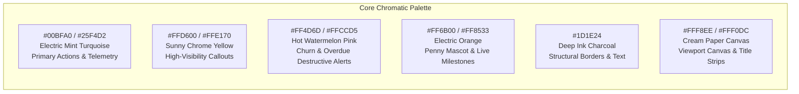

# 🎨 UI/UX DESIGN & IMPLEMENTATION SPECIFICATION
### *Google Stitch Reference Alignment: Vibrant 90s Retro Modern SaaS*

---

## 1. Visual Design Philosophy & Heritage

Brightloop departs from sterile, monochrome enterprise SaaS interfaces by embracing **1990s Retro-Modern Neo-Brutalism**. 

Adapted directly from Google Stitch specifications in `C:\Users\LENOVO\Downloads\new ui\vibrant_90s_retro_modern_saas\DESIGN.md`:
- **Physical Tactility**: Rejects blurry Gaussian drop-shadows in favor of crisp $3\text{px} - 4\text{px}$ hard offset ink shadows (`box-shadow: 4px 4px 0px #1D1E24`).
- **Architectural Framing**: Buttons, inputs, tables, and modal windows feature uncompromising $2\text{px} - 3\text{px}$ solid `#1D1E24` charcoal borders.
- **Stacked Window Metaphors**: Core dashboards and sub-panels feature dedicated retro window header bars styled with isometric control icons (`_`, `□`, `×`).
- **Nostalgic Paper Canvas**: Main viewports utilize warm creamy paper backdrops (`#FFF8EE`) with subtle $24\text{px}$ hairline gridlines referencing early personal computing desktop environments.

---

## 2. Design Tokens & Color System



| Token Name | Hex Code | Semantic Role in Brightloop UI |
| :--- | :--- | :--- |
| `surface` / `canvas-cream` | `#FFF8EE` | Tactile main viewport background with 24px grid texture |
| `cream-dim` | `#FFF0DC` | Sidebar docks, card title strips, and subtle table zebra striping |
| `primary` | `#00BFA0` | Main interactive buttons, primary pills, active tab highlights |
| `primary-container` | `#25F4D2` | High-voltage active window banners, mission control headers |
| `secondary` | `#D4A500` | Secondary button outlines, warning tags |
| `secondary-container` | `#FFD600` | Bright callout ribbons, badge indicators, Quick-Action buttons |
| `tertiary` / `error` | `#FF4D6D` | Overdue invoice alerts, churn risks, destructive actions |
| `electric-orange` | `#FF6B00` | Penny the Coin mascot body, trial expiration highlights |
| `ink-charcoal` | `#1D1E24` | 2px/3px borders, hard drop shadows, high-contrast headings |

---

## 3. Typographic System

- **Display & Section Titles (`Space Grotesk`)**: Geometric, sharp, and commanding. Heavy weights (`700`, `800`) paired with subtle negative letter-spacing (`-0.02em`) evoke 90s computing magazines.
- **Body & Data Grids (`Plus Jakarta Sans`)**: Neutralized geometric sans with exceptional legibility over dense financial ledgers and analytical tables.
- **Terminal Micro-Labels (`Space Grotesk Uppercase`)**: Tracked micro-labels (`label-sm`, `10px - 12px`, letter spacing `0.06em`) used for KPI descriptions, status pills, and telemetry badges.

---

## 4. Reusable Component Catalog

### 4.1 Retro Window Card (`WindowCard.tsx`)
A signature 90s desktop window container:
- Top bar ($36\text{px}$ height) filled with `#FFF0DC` or `#25F4D2`, separated by a $3\text{px}$ solid `#1D1E24` border.
- Features uppercase `Space Grotesk` title on the left with terminal icon.
- Features three mechanical bordered square icons on the right: Minimize (`_`), Maximize (`□`), Close (`×` with `#FF4D6D` fill).
- Container surface is crisp white (`#FFFFFF`) with $4\text{px} \times 4\text{px}$ solid `#1D1E24` hard shadow.

### 4.2 Neo-Brutalist Buttons (`NeoButton.tsx`)
Tactile physical buttons engineered for instant tactile feedback:
- **Primary**: Background `#25F4D2`, border $2.5\text{px}$ `#1D1E24`, shadow `3px 3px 0px #1D1E24`.
- **Secondary**: Background `#FFD600`, border $2.5\text{px}$ `#1D1E24`, shadow `3px 3px 0px #1D1E24`.
- **Destructive**: Background `#FF4D6D`, text `#FFFFFF`, border $2.5\text{px}$ `#1D1E24`, shadow `3px 3px 0px #1D1E24`.
- **Interactive Physics**: `active:translate(2px, 2px)` with `box-shadow: 1px 1px 0px #1D1E24`.

### 4.3 Five-Stage Lifecycle Pipeline Stepper (`LifecycleStepper.tsx`)
Reproduces the 5-phase interactive ribbon directly from `brightloop_subscription_management/code.html`:
1. `Phase 01: Draft` (Warm Cream / Soft Yellow `#FFF8EE`).
2. `Phase 02: Quotation` (Warm Sunburst Amber `#FFF4D4`).
3. `Phase 03: Confirmed` (Cyan Pop `#E0F9FF`).
4. `Phase 04: Active` (Electric Mint `#00E5C9` with pulsing live dot).
5. `Phase 05: Closed` (Neutral Charcoal / Dim Gray `#EDE5D6`).
Clicking any phase fast-filters the underlying subscription data grid in $<50\text{ms}$.

### 4.4 Bento Grid KPI Cards (`MetricBentoCard.tsx`)
7-card bento grid displaying core recurring metrics:
- Monthly Recurring Revenue (MRR) with custom retro sparkline SVG.
- Total Revenue YTD with segmented LED meter gauge.
- Active Subscriptions with target completion percentage.
- Customer Volume with retention badge.
- Active SKUs / Plan families count.
- Outstanding Cash awaiting collection.
- Overdue Invoices with 1-click review action button.

### 4.5 Penny Mascot Dispatch Desk (`PennyDispatchBanner.tsx`)
Dedicated mascot window banner:
- Houses Penny the Coin vector illustration.
- Emits real-time speech bubble with high-priority business telemetry.
- Direct quick-action links to resolve anomalies (e.g., "Chase 14 Overdue Invoices").

---

## 5. Screen Layout Architecture

```
┌────────────────────────────────────────────────────────────────────────┐
│  BRIGHTLOOP RETRO OS NAVIGATION BAR                                   │
│  [Logo] Brightloop SUB.SYS_v2.4  | Mode: [Admin|Staff|Portal] | ⌘K Search│
├──────────────┬─────────────────────────────────────────────────────────┤
│ SIDEBAR      │ MAIN APPLICATION CANVAS                                 │
│              │                                                         │
│ ▤ Overview   │ ┌─────────────────────────────────────────────────────┐ │
│ 📦 Products  │ │ MISSION CONTROL // LIVE MRR MONITOR (90s Title Strip)│ │
│ 📑 Plans     │ │ [Penny Avatar] "142 renewals running smooth!"       │ │
│ 👥 Customers │ └─────────────────────────────────────────────────────┘ │
│ 📝 Quotes    │ ┌──────┐ ┌──────┐ ┌──────┐ ┌──────┐ ┌──────┐ ┌──────┐   │
│ 🔄 Subs      │ │ MRR  │ │ REV  │ │ SUBS │ │ CUST │ │ OUTS │ │ OVER │   │
│ 🧾 Invoices  │ └──────┘ └──────┘ └──────┘ └──────┘ └──────┘ └──────┘   │
│ 🏷️ Discounts │ ┌─────────────────────────────┐ ┌─────────────────────┐ │
│ 💳 Payments  │ │ Trailing Velocity Chart     │ │ Tier Donut Gauge    │ │
│ 📊 Analytics │ │ (Dual-bar ARR vs Churn SVG) │ │ (Enterprise 45%)    │ │
│ ──────────── │ └─────────────────────────────┘ └─────────────────────┘ │
│ ⚙️ Settings  │ ┌─────────────────────────────────────────────────────┐ │
│ 🚪 Logout    │ │ Recent Subscriptions & Overdue Chase Ledger         │ │
│              │ └─────────────────────────────────────────────────────┘ │
└──────────────┴─────────────────────────────────────────────────────────┘
```

