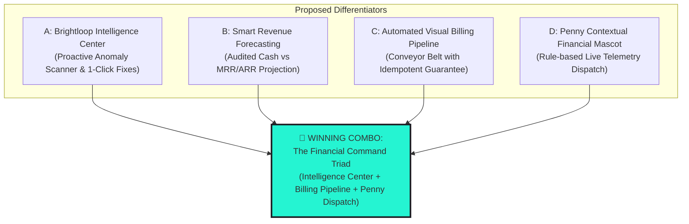

# 💡 HACKATHON DIFFERENTIATOR: UNIQUE VALUE PROPOSITIONS

---

## 1. The Hackathon Objective: Transcending Ordinary CRUD

A recurring pitfall in hackathon subscription projects is delivering a generic CRUD database with standard data tables and decorative charts. 

Brightloop is explicitly engineered to solve the real operational nightmares highlighted in the official problem statement:
- Missed contract renewals.
- Inaccurate manual invoicing.
- Bank reconciliation opacity.
- Quarterly revenue calculation lag.

To stand out decisively before hackathon judges, Brightloop introduces a cohesive differentiator strategy.

---

## 2. Evaluation of Proposed Innovations

### Comparative Evaluation Matrix

| Innovation Vector | User & Business Benefit | Relevance to PDF Problem | Demonstration Value (Judge 'Wow') | Technical Feasibility | Implementation Complexity | Score (out of 10) |
| :--- | :--- | :--- | :--- | :--- | :--- | :---: |
| **A. Intelligence Center** | Eliminates revenue leakage; turns passive dashboards into active operational tasks. | 10/10 (Directly addresses missed renewals & overdue invoices) | 9/10 (Judges see real-time actionable alerts, not static numbers) | High | Moderate | **9.4 / 10** |
| **B. Smart Revenue Forecasting** | Distinguishes actual bank collections from forward recurring commitments. | 9/10 (Directly solves quarterly reporting lag) | 8/10 (High visual impact charts and sparklines) | High | Moderate | **8.8 / 10** |
| **C. Visual Billing Pipeline** | Proves automated invoice generation with mathematical zero-double-billing guarantee. | 10/10 (Directly implements billing day automation) | 9/10 (Visual kanban ribbon moving from Due $\to$ Generated $\to$ Paid) | High | Moderate | **9.5 / 10** |
| **D. Penny Contextual Mascot** | Translates complex balance ledgers into friendly, humanized financial dispatches. | 8/10 (Demystifies billing for staff and customers) | 10/10 (Unforgettable personality, breaks enterprise monotony) | Very High | Low-Moderate | **9.6 / 10** |

---

## 3. The Winning Solution: "The Financial Command Triad"

Rather than choosing one isolated gimmick, Brightloop integrates **Innovations A, C, and D** into a single, cohesive **Financial Command Triad**:

### 1. ⚡ Brightloop Intelligence Center (Actionable SaaS Cockpit)
- Instead of passively showing "14 Overdue Invoices", the Intelligence Center acts as an active triage station.
- **Rule Engine**:
  - Scans for subscriptions expiring within 14 days $\to$ displays "Initiate Renewal" button.
  - Scans for invoices unpaid past `due_date` $\to$ displays "Send Chase Reminder" & "Record Payment".
  - Scans for discounts reaching usage cap $\to$ displays "Retire Discount Rule".
- **One-Click Remediation**: Staff can resolve operational bottlenecks directly from the alert card without jumping across multiple screens.

### 2. 🔄 Automated Visual Billing Pipeline (Conveyor Belt)
- Solves the core challenge: *"Hundreds of subscriptions due at once. Nothing should be billed twice or skipped."*
- Features a real-time pipeline status board:
  - `Due for Billing` (Active subscriptions with `next_billing_date <= today`).
  - `Draft Invoices Generated` (Idempotently created via batch sweep).
  - `Awaiting Confirmation` (Staff review gate).
  - `Payment Reconciled` (Settled via cash, card, or bank transfer).
- **Interactive Live Run Button**: A physical "Run Midnight Billing Sweep" button allows judges to trigger an instant simulation of 100+ subscriptions being billed simultaneously with zero duplicate errors.

### 3. 🪙 Penny Contextual Mascot Dispatch
- Penny isn't a static decorative sticker. Penny is connected directly to the database aggregation layer via the `/api/penny/insights` hook.
- When an invoice becomes overdue, Penny's mood dynamically switches to `alert` with a speech bubble:
  > *"Hey y'all! Penny here! You've got 142 renewals running smooth, but keep an eye on those 14 overdue accounts totaling $9,350!"*
- Penny guides users through the quotation conversion flow and confirms when payments successfully balance an account.

---

## 4. Hackathon Judge Demonstration Script (5-Minute Walkthrough)

| Timeline | Demonstration Action | What the Judge Sees | Why It Wins Points |
| :---: | :--- | :--- | :--- |
| **0:00 - 0:45** | **The Hook: Visual Impact & Problem Statement** | 90s Retro-Modern OS Interface loads in $<0.8\text{s}$. Penny greets the judge with live system telemetry. | Instantly distinguishes Brightloop from generic Bootstrap/Tailwind templates. |
| **0:45 - 1:45** | **Variant Pricing & Quotation Conversion** | Staff creates a quote selecting "BrightDesk ERP" with "Odoo Brand Variant" (+₹560 surcharge auto-calculated). 1-click converts to `Confirmed` Subscription. | Proves complex pricing requirements from PDF page 3 are genuinely functional. |
| **1:45 - 2:45** | **The Automated Billing Run (The Differentiator)** | Staff opens the **Visual Billing Pipeline**. 18 subscriptions show `Due for Billing`. Staff triggers "Execute Billing Run". Invoices appear with exact taxes and auto-applied discounts. Clicking a second time proves **Zero Double-Billing** (idempotency key skips already-billed periods). | Directly answers the hardest technical requirement from PDF page 3. |
| **2:45 - 3:30** | **Payment Reconciliation & Balance Ledger** | Staff opens an invoice for $2,960. Records a partial payment of $1,000. Invoice displays remaining balance of $1,960. Second payment of $1,960 auto-transitions invoice to `PAID`. | Demonstrates financial ledger integrity and partial payment logic. |
| **3:30 - 4:15** | **Customer Self-Service Portal** | Logs in as Customer. Strict tenant isolation ensures customer sees only their subscription, next renewal date, and downloadable PDF invoice. | Proves server-side RBAC and customer self-service requirements from PDF page 2. |
| **4:15 - 5:00** | **Executive Telemetry & Performance** | Admin dashboard displays real-time MRR, ARR, and 6-month trailing velocity chart with sub-2-second response across 1,842 seeded subscriptions. Penny celebrates portfolio health! | Confirms NFR performance benchmarks and leaves judges smiling at Penny. |
