# 🎬 BRIGHTLOOP: VIDEO DEMO & PITCH RECORDING SCRIPT
### *Master Walkthrough, Visual Cues & Voiceover Narration*
#### Optimized for Hackathon Video Submissions (3-Minute & 5-Minute Versions)

---

## 📌 Executive Video Strategy

This script is structured to deliver maximum visual and technical impact to hackathon judges within strict video time constraints. It highlights the real-world operational problem, proves zero double-billing math, demonstrates tactile UX interactions, and presents our vibrant 90s retro neo-brutalist identity and Penny mascot.

```mermaid
flowchart LR
    S1["Scene 1 (0:00-0:40)\nThe Hook & Problem Space"] --> S2["Scene 2 (0:40-1:20)\nCatalog & +₹560 Odoo Rule"]
    S2 --> S3["Scene 3 (1:20-2:10)\n1-Click Convert & Confetti Fanfare"]
    S3 --> S4["Scene 4 (2:10-3:00)\nBilling Sweep & Zero Double-Billing"]
    S4 --> S5["Scene 5 (3:00-3:50)\nPayment Settlement & Portal 360"]
    S5 --> S6["Scene 6 (3:50-4:30)\n13ms SLA Benchmark & Wrap-up"]

    style S1 fill:#FF4D6D,stroke:#1D1E24,stroke-width:2px,color:#fff
    style S2 fill:#FFD600,stroke:#1D1E24,stroke-width:2px
    style S3 fill:#25F4D2,stroke:#1D1E24,stroke-width:2px
    style S4 fill:#00C2E8,stroke:#1D1E24,stroke-width:2px
    style S5 fill:#FFE170,stroke:#1D1E24,stroke-width:2px
    style S6 fill:#00BFA0,stroke:#1D1E24,stroke-width:2px
```



---

## 🎙️ Video Production Guidelines

| Element | Specification | Recommendation |
| :--- | :--- | :--- |
| **Screen Resolution** | $1920 \times 1080$ (1080p, 16:9) | Browser zoomed to 100% or 110% for crisp typography. |
| **Target URL** | `http://localhost:3000` | Ensure precompiled production build is running (`npm run start`). |
| **Audio Setup** | Native Web Audio SFX ON | Keep sound effects unmuted in the header (`🔊 SFX`) so Penny's coin chimes and tactile switch clicks record clearly. |
| **Cursor Style** | High-visibility mouse pointer | Smooth, deliberate mouse motions without rapid jitter. |

---

## ⏱️ Version A: The 3-Minute Rapid Pitch (Fast Track)

*Best suited for strict 3-minute video submission rules.*

### 0:00 – 0:35 | The Operational Problem & Brightloop OS
- **Screen View**: Open browser to `http://localhost:3000`. Show full-bleed dashboard with Bloomberg infinite marquee ribbon and Penny Mission Control banner.
- **Voiceover**:
  > *"Judges, recurring revenue is the lifeblood of modern SaaS, but managing it is an operational nightmare. Spreadsheets lose track of renewals, manual invoice drafting causes catastrophic revenue leakage, and automated retry loops risk double-billing customers.*
  > 
  > *Meet **Brightloop**—a unified, idempotent recurring revenue operating system built with Next.js 15, React 19, and a vibrant 90s retro neo-brutalist design language."*

### 0:35 – 1:15 | Dynamic Pricing & 1-Click Quotation
- **Screen Action**: Click `📑 Proposals & 1-Click Convert` on the Quick Cockpit bar (or press `⌘K` $\to$ jump to Quotations).
- **Voiceover**:
  > *"Let's test the challenge's core pricing requirement: an enterprise product with variant surcharges. In our quotation builder, selecting the 'Odoo Brand Edition' automatically injects the mandatory $+₹560/\text{seat}$ surcharge, applies standard 18% GST, and calculates our total in Indian Rupees.*
  > 
  > *When the customer accepts, staff don't re-enter data. One click on **'Convert to Subscription'**..."*
- **Action**: Click "Convert to Subscription". Listen to the victory fanfare audio and watch the celebration confetti burst.
  > *"Instantly converts into a confirmed, active contract on our deterministic 5-stage state machine."*

### 1:15 – 2:05 | Billing Day & Zero Double-Billing (The "Climax")
- **Screen Action**: Jump to `/invoices` (Invoices Ledger).
- **Voiceover**:
  > *"Now it's Billing Day. Hundreds of recurring subscriptions are due simultaneously. Watch our automated billing engine."*
- **Action**: Click **"Run Automated Billing Sweep"**.
  > *"In just 13 milliseconds, draft invoices are generated for all eligible accounts. But what happens if an administrator clicks it again or a server worker retries?"*
- **Action**: Click **"Run Automated Billing Sweep"** a second time immediately.
  > *"Notice the notification: '0 duplicates generated, 18 periods safely skipped.' Every single billing period is guarded by a deterministic SHA-256 idempotency key. It is mathematically impossible to double-bill a customer."*

### 2:05 – 2:40 | Reconciled Payments & Customer Portal
- **Screen Action**: Click "Record Payment" on an invoice. Enter a partial payment of ₹5,000 via UPI.
- **Voiceover**:
  > *"Cash collection is seamless. We record partial settlements via UPI, credit card, or bank transfer, automatically updating the remaining balance due.*
  > 
  > *And customers aren't left in the dark. Switching to the **Customer Self-Service Portal**, tenants review their renewal countdowns, view itemized tax invoices, and settle balances directly with 1-click Pay Now."*

### 2:40 – 3:00 | 13ms SLA Benchmark & Wrap-Up
- **Screen Action**: Return to Dashboard. Point to the live SLA indicator on the marquee ticker (`SLA LATENCY: 13ms // 99.3% HEADROOM`).
- **Voiceover**:
  > *"With over 1,800 simulated subscriptions in our database, Brightloop executes complex financial sweeps in just 13 milliseconds—more than 150 times faster than the hackathon SLA requirement.*
  > 
  > *100% Indian Rupee unification, 8 out of 8 unit tests passed, and zero double-billing guaranteed. Brightloop turns subscription chaos into predictable revenue. Thank you!"*

---

## 🎬 Version B: The 5-Minute Master Walkthrough (Comprehensive)

*Full-length script with scene-by-scene audio cues, camera blocking, and deep-dive technical explanations.*

```
================================================================================
SCENE 1: THE HOOK & OPERATIONAL CHAOS
TIMECODE: 0:00 – 0:45
SCREEN: Dashboard Overview (http://localhost:3000)
AUDIO: Ambient studio voiceover + subtle retro mechanical click on page entry
================================================================================
```

#### [Visual Action]
Start full screen on `http://localhost:3000`. The continuous marquee ticker smoothly glides across the top. The bento grid displays `₹1,48,250/mo` MRR, `₹1.78M` ARR, and `₹9,350` overdue receivables. Hover over Penny the Coin mascot—Penny blinks and displays an energetic welcoming pose.

#### [Voiceover Narration]
> *"Judges, every subscription-based business faces the same terrifying operational bottleneck:*
> 
> *Subscriptions tracked across disconnected spreadsheets, renewals remembered only by whoever noticed first, manual invoice drafting that introduces human error, and banking reconciliation that lags weeks behind.*
> 
> *Worst of all is the silent killer of customer trust: duplicate charges caused by non-idempotent billing retries.*
> 
> *This is **Brightloop**—an enterprise-grade Subscription Management Operating System built from the ground up to eliminate revenue leakage, guarantee zero double-billing, and humanize recurring finance."*

---

```
================================================================================
SCENE 2: VISUAL IDENTITY & THE PENNY INTELLIGENCE DESK
TIMECODE: 0:45 – 1:20
SCREEN: Bento Metric Grid & Floating Penny Assistant
AUDIO: Penny Coin Chime (Click Penny in bottom right to trigger 8-bit audio)
================================================================================
```

#### [Visual Action]
1. Slowly scroll through the 12-column architectural Bento Grid.
2. Highlight Card 1 (MRR Velocity with dynamic SVG sparkline), Card 2 (Audited Cash Collections with the 84%/16% dual progress meter), and Card 3 (Urgent Overdue Receivables in high-contrast watermelon coral).
3. Click the floating **Penny Mascot** at the bottom-right corner. The drawer animates open with the two-tone retro coin chime. Switch tabs: `Advice` $\to$ `Telemetry` $\to$ `SLA Benchmark`.

#### [Voiceover Narration]
> *"Brightloop is styled in a bespoke 1990s Retro Neo-Brutalist design language: thick solid ink borders, tactile 75-millisecond button physics, and high-contrast telemetry.*
> 
> *Down in the corner is **Penny the Coin**, our proactive AI financial mascot. Penny isn't a decorative sticker—she connects directly to our database telemetry API. Right now, Penny flags 14 overdue accounts risking ₹9,350 in uncollected cash and alerts our team to 142 upcoming renewals.*
> 
> *Clicking her telemetry drawer gives instant visibility into our live active contracts and system latency."*

---

```
================================================================================
SCENE 3: DYNAMIC PRICING ENGINE & THE +₹560 ODOO SURCHARGE
TIMECODE: 1:20 – 2:05
SCREEN: Products Catalog (/products) and Quotations Builder (/quotations)
AUDIO: Mechanical switch click audio upon button presses
================================================================================
```

#### [Visual Action]
1. Press `⌘K` to open the Command Palette. Type `Products`, hit `Enter`.
2. Point out the `Odoo Brand Edition` variant card showing `+₹560`.
3. Navigate to `/quotations`. Click **"+ Draft New Quotation"**.
4. In the modal, select Product: `BrightDesk Pro`, select Variant: `Odoo Brand Edition (+₹560)`.
5. Point to the live pricing math breakdown at the bottom of the modal: Subtotal, 18% GST, and Total in Indian Rupees (`₹`).
6. Click **"Save as Draft Quotation"**.

#### [Voiceover Narration]
> *"Now let's examine the core product catalog and pricing requirements from the challenge brief.*
> 
> *Under our Products catalog, we have full support for multi-variant pricing. Notice our Odoo Brand surcharge rule: selecting Odoo Brand dynamically adds $+₹560/\text{seat}$ to the base price.*
> 
> *When our sales reps draft a commercial proposal, they don't do mental arithmetic. Brightloop automatically computes the variant surcharge, applies standard 18% GST compliance, and presents the exact total in Indian Rupees.*
> 
> *Let's save this proposal."*

---

```
================================================================================
SCENE 4: 1-CLICK PROPOSAL CONVERSION & CELEBRATION FANFARE
TIMECODE: 2:05 – 2:40
SCREEN: Quotations Table (/quotations)
AUDIO: Web Audio Synthesizer Fanfare + Confetti Cannon
================================================================================
```

#### [Visual Action]
1. Locate the newly drafted quotation on the top row of the table.
2. Click the bright turquoise **"1-Click Convert to Subscription"** button.
3. Sound synthesizer plays a triumphant retro fanfare while vibrant multi-colored confetti cannons shoot across the screen.
4. The status badge flips to `ACCEPTED` and the row displays `Converted to Sub`.
5. Navigate to `/subscriptions` to show the newly activated contract on the 5-stage pipeline:
   $$\text{Draft} \longrightarrow \text{Quotation} \longrightarrow \mathbf{Confirmed} \longrightarrow \text{Active} \longrightarrow \text{Closed}$$

#### [Voiceover Narration]
> *"Once the client signs, watch what happens. Instead of manually copying details into another CRM, staff simply click **'1-Click Convert'**.*
> 
> *[Audio Fanfare & Confetti Burst]*
> 
> *Brightloop atomically transitions the quote into a Confirmed Subscription, snapshots line-item pricing, assigns a unique contract ID, and schedules the recurring billing cadence on our 5-stage deterministic state machine."*

---

```
================================================================================
SCENE 5: BILLING DAY SWEEPS & THE CRYPTOGRAPHIC ZERO DOUBLE-BILLING LOCK
TIMECODE: 2:40 – 3:35
SCREEN: Invoices Ledger (/invoices)
AUDIO: Double-click audible confirmation
================================================================================
```

#### [Visual Action]
1. Navigate to `/invoices`.
2. Click **"Run Midnight Billing Engine"**.
   - Toast displays: `✅ Invoices generated successfully!`
3. Show new draft invoices appearing in the ledger.
4. Now, deliberately click **"Run Midnight Billing Engine"** a second time.
   - Toast displays: `🛡️ 0 invoices created, 18 duplicate periods safely skipped by Idempotency Key.`
5. Hover over the SHA-256 Verified indicator on the KPI card.

#### [Voiceover Narration]
> *"Now comes the technical climax: **Billing Day**.*
> 
> *In traditional systems, billing hundreds of active contracts requires slow batch scripts that frequently fail halfway through—or worse, charge customers twice during retries.*
> 
> *Let's run our billing sweep.*
> 
> *[Click Run Engine]*
> 
> *Our engine evaluates all due subscriptions and generates itemized draft invoices.*
> 
> *Now, watch what happens if a network timeout occurs and the script runs again, or an admin accidentally double-clicks the button.*
> 
> *[Click Run Engine again]*
> 
> *Look at that: '0 duplicates created, 18 periods safely skipped.'*
> 
> *Every single invoice is protected by a deterministic SHA-256 hash of the subscription ID and billing cycle dates:
> $$\text{Key} = \text{SHA256}(\text{SubID} + \text{PeriodStart} + \text{PeriodEnd})$$
> Backed by a composite unique database index, double-billing is mathematically impossible."*

---

```
================================================================================
SCENE 6: MULTI-METHOD PAYMENT SETTLEMENT & 360 CUSTOMER PORTAL
TIMECODE: 3:35 – 4:15
SCREEN: Payment Modal & Customer Portal (/portal)
AUDIO: Mechanical click & confirmation toast
================================================================================
```

#### [Visual Action]
1. On an overdue invoice with ₹9,350 balance, click **"Record Payment"**.
2. Enter partial amount `₹5,000`, select method `UPI`, click `Confirm Payment`.
   - Balance due instantly drops to `₹4,350` and status changes to `PARTIALLY_PAID`.
3. Settle remaining `₹4,350` via `Bank Transfer` $\to$ status flips to bright green `PAID`.
4. Switch to the **Customer Portal** (`/portal` or use sidebar workspace switcher).
   - Show tenant-isolated view for Acme Corp.
   - Click **"Pay Now"** or click **"Print PDF"** to open the official tax invoice modal.

#### [Voiceover Narration]
> *"Settling payments is just as rigorous. Brightloop handles partial payments effortlessly—recording ₹5,000 via UPI immediately updates the ledger to Partially Paid with a remaining balance of ₹4,350. Settle the balance, and the account marks Paid.*
> 
> *Meanwhile, customers enjoy their own self-service portal. Tenants view their active contracts, renewal dates, and click 'Print PDF' to view a clean, audited tax invoice with 18% GST line items and bank reconciliation receipts."*

---

```
================================================================================
SCENE 7: BENCHMARK SLA VERIFICATION & CLOSING PITCH
TIMECODE: 4:15 – 4:45
SCREEN: Reports & Latency Benchmark (/reports & Floating Penny Benchmark Tab)
AUDIO: Two-tone Penny conclusion chime
================================================================================
```

#### [Visual Action]
1. Open the `/reports` view showing audited accounting tables and the Export to CSV button.
2. Click **"Run SLA Latency Benchmark"** in the Quick Cockpit bar or Penny Assistant.
   - Benchmark popup displays: `⚡ Latency: 13ms (>150x faster than 2,000ms SLA)!`
3. Return to the full Dashboard with both Penny and the continuous marquee ticker in view.

#### [Voiceover Narration]
> *"Finally, let's verify our performance. The hackathon challenge mandated a response time under 2,000 milliseconds.*
> 
> *Let's trigger our live latency benchmark.*
> 
> *[Click Benchmark]*
> 
> *Our engine executed in just **13 milliseconds**—over 150 times faster than the required SLA, with 99.3% headroom!*
> 
> *To summarize:*
> - *100% Indian Rupee unification,*
> - *ACID-compliant SHA-256 zero double-billing protection,*
> - *Automatic +₹560 Odoo variant surcharges,*
> - *8 out of 8 unit tests passed with 100% score,*
> - *And sub-15ms performance.*
> 
> *Brightloop turns subscription billing from a stressful chore into an automated, mathematically bulletproof growth engine. Thank you!"*

---

## 📋 Hackathon Judge Q&A Cheat Sheet

Keep these technical defenses ready if judges ask questions after the video:

| Question | Technical Defense |
| :--- | :--- |
| **"How do you ensure zero double-billing across multiple server workers?"** | *"We generate an idempotency hash `SHA256(subId + periodStart + periodEnd)` and enforce a database-level `UNIQUE` index constraint inside an atomic Prisma transaction. Even under concurrent load, duplicate inserts trigger constraint collisions and rollback safely."* |
| **"How is the +₹560 Odoo surcharge calculated across bulk seat quantities?"** | *"Our pricing engine calculates effective unit price as $P_{\text{eff}} = P_{\text{base}} + \sum S_{\text{variant}}$. The $+₹560$ is applied per seat before line-item quantity multiplication and 18% GST tax application, matching the official challenge specifications."* |
| **"Is Penny the Coin hardcoded or reactive?"** | *"Penny is connected to our live `/api/penny/insights` telemetry route. She actively queries SQLite/PostgreSQL to detect aging overdue receivables, churn thresholds, and renewal clusters, adapting her mood and dialogue in real time."* |
| **"Are the sound effects loading external MP3 files?"** | *"No. All sound effects are synthesized 100% procedurally on the client using the browser's native Web Audio API (`AudioContext`). It adds zero network bytes and zero asset latency."* |
